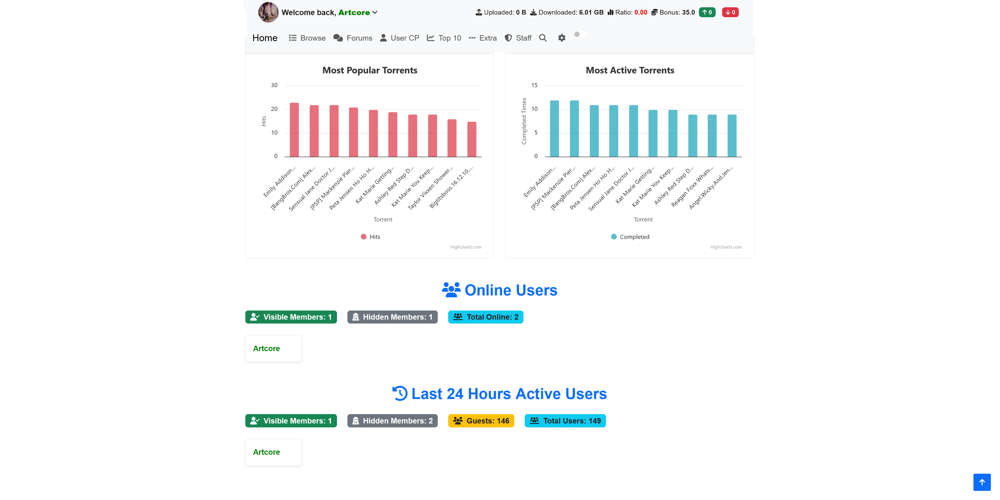
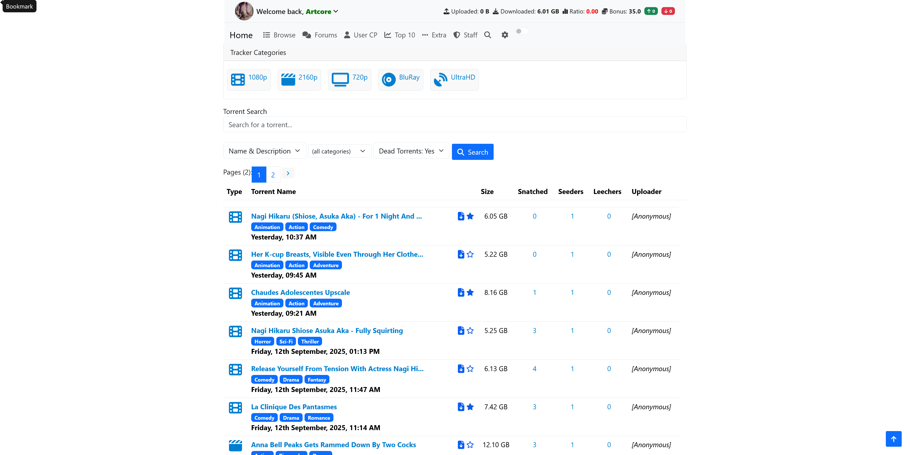
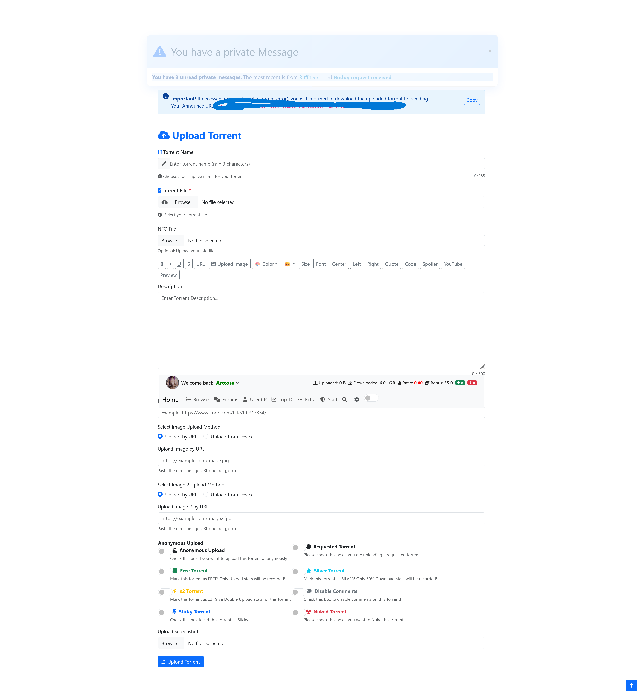
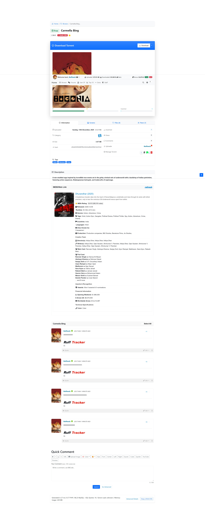
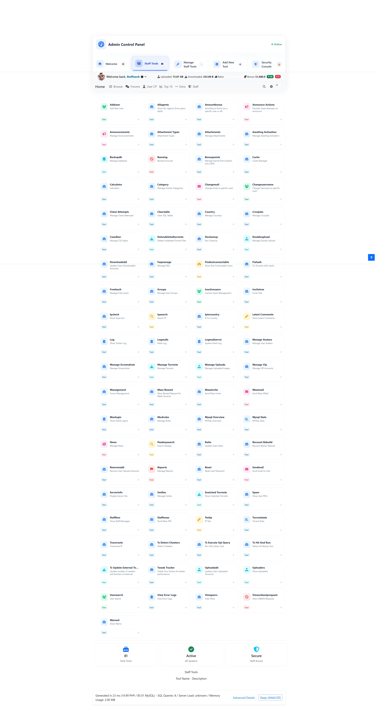

# 🎬 PHP Torrent Tracker

[](https://www.php.net/)
[](https://www.mysql.com/)
[](https://getcomposer.org/)
[](LICENSE)

> ⚡ A private **BitTorrent tracker** with a forum, built on a heavily reworked MyBB 1.8 core:
> announce with anti-cheat, torrent parser (BitTorrent v1 + v2), AJAX chat, reactions,
> notifications, requests & offers, and a full staff panel.

Running live at **[ArtCore Gangsta](https://artcore-gangsta.eu)**. Perfect for **private communities**,
testing torrent workflows, or learning how trackers work under the hood.

---

## 📸 Screenshots 

### 🔹 Main Page



### 🔹 Browse Torrent 


### 🔹 Upload page



### 🔹 Details Page



### 🔹 Forum


### 🔹 Admin Panel


---

## ✨ Features

**Tracker**
- 🔗 Announce endpoint with real-time anti-cheat checks plus a cron-based cheat detector
- 📂 Torrent parsing via [arokettu/torrent-file](https://github.com/arokettu/torrent-file), **BitTorrent v2 (BEP 52)** info-hash support
- 🧲 Magnet links for external / cross-seeded torrents
- 🎁 Promotions: Free, Silver, 2× upload, 30% leech — automatic on upload or set by staff
- 🎯 Hit & Run with automatic warnings and bans, VIP / staff exemptions
- 🏷️ Claims (keep-seeding commitments) and seed bonus points with a full bonus log
- 🙋 **Requests & Offers** marketplace with votes, bounties and auto-matching to uploads
- 🎓 Exams / tasks for new members
- ⭐ 10-star ratings for torrents and forum threads

**Community**
- 💬 **AJAX chat**: replies, @mentions with sound, private 1:1 dialogs with block list and reports, pinned message, staff archive & search
- 🤖 **Chat bot** posts new torrents (as embedded torrent cards), requests and offers — each event switchable in settings
- 😀 **Reactions** with the site's own smilies on chat messages, torrent comments and forum posts
- 🔔 **Notification center** (header bell): replies, mentions, filled requests, awards, subscriptions
- 🗨️ Forum with attachments, BBCode editor, `[torrent=ID]` cards, `[spoiler]`, `[nfo]`, tables
- 🌍 Full **English / Russian** interface, switchable per user

**Security**
- 🔐 Mandatory TOTP 2FA for staff with backup codes; email alerts on 2FA changes and new-device logins
- 🖥️ Known-devices tracking and session management ("log out everywhere")
- 🛡️ CSRF protection on all POST / AJAX actions, prepared statements everywhere, bcrypt passwords
- 🕵️ Fake-staff detection and auto-expiring IP bans

**Staff Panel**
- 📈 Dashboard with KPI tiles and stats; activity heatmap
- 👤 Per-user tools: activity log, security, hit & run history, audit log, usage charts
- 🧰 Upload / download / ratio managers, mass reseed, torrent health, latest comments moderation (move / copy / merge)
- ⚙️ Settings editor with logging of every change; cron manager

**Code**
- 🆕 Typed PHP 8.5 codebase (`declare(strict_types=1)`, `match`, typed signatures)
- 🧹 Vanilla JS — no jQuery dependency; Bootstrap 5 with dark theme
- 🎨 Contextual error pages (404 / 403 / 401 / 500)
- ⚙️ Web installer, no table-prefix legacy

---

## ⚡ Installation

### Option A — Web Installer (Recommended)
1. Upload all files to your web server
2. Open `http://yoursite.com/install.php` in your browser
3. Follow the step-by-step setup wizard:
   - ✅ Requirements check
   - 🗄️ Database configuration
   - 🌐 Site settings
   - 👤 Admin account creation
   - 🚀 One-click install
4. Delete `install.php` after installation

---

## 📌 Requirements
- PHP 8.5+
- MySQL 9.7 LTS
- Composer
- mod_rewrite (Apache) or equivalent

## 📁 Directory Permissions
```bash
chmod 755 torrents/
chmod 755 uploads/
chmod 755 uploads/avatars/
chmod 755 cache/
chmod 666 include/config.php
chmod 666 include/settings.php
chmod 666 include/config_announce.php
```
